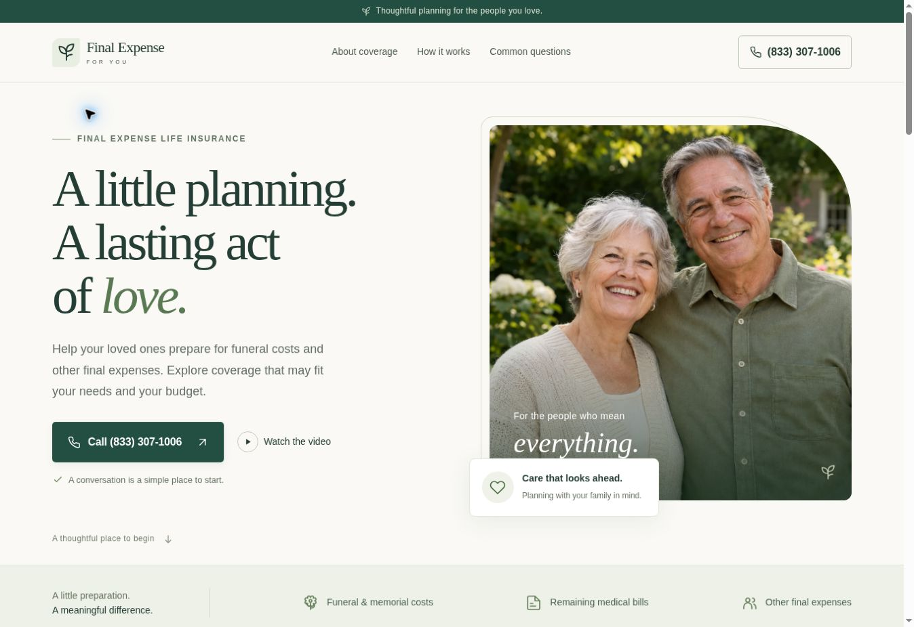

# Final Expense For You

A responsive pay-per-call microsite with a home page, separate privacy policy, prominent call buttons, sticky mobile call bar, coverage overview, six FAQs, and the requested YouTube video.

Telephone: **(833) 307-1006**. Video: https://www.youtube.com/watch?v=G5zC19ZbSII

## Build

Use Node.js 22 or newer and run:

    npm run build

The complete deployable site is written to dist/. No package dependencies or API key are needed. Serve dist/ through a web server; the site uses root-relative asset and page URLs.

## Edit

- site.config.mjs — shared phone, video ID, brand, policy date, URL, and indexing settings.
- site/index.html — home page.
- site/privacy-policy/index.html — privacy policy.
- site/partials/header.html and footer.html — shared navigation, calls, and disclosures.
- site/assets/styles.css — responsive styling.
- site/assets/site.js — optional video controls.
- site/assets/meta-pixel.js — shared Meta Pixel initialization and PageView event.
- scripts/build-static.mjs — dependency-free template assembly and asset copying.

Rebuild after editing. Double-brace template values are filled from site.config.mjs.

## Netlify hosting

Import this GitHub repository in Netlify. The included netlify.toml sets the build command to npm run build, the publish directory to dist, Node version 22, and public search indexing.

Netlify's URL environment variable supplies the canonical domain and sitemap origin. Set SITE_URL explicitly if a different canonical domain is required. There are no dependencies to install.

On another static host, publish the contents of dist/. Set SITE_URL to the final origin and SITE_INDEXABLE=true for a public indexable version. The default review build is noindex and does not invent a canonical domain. Host at a domain root, not a GitHub project subdirectory.

The .openai/hosting.json file retains the existing ChatGPT Sites preview identity. Preview access is managed separately from the GitHub repository and Netlify.

## Calls and measurement

Every call link opens tel:+18333071006. The website does not place a call automatically. Routing, availability, qualification, and payouts are handled by the owner's telephone/pay-per-call provider.

Meta Pixel **2151654019078665** is installed on every generated page: home, privacy policy, and 404. The shared head loads a local bootstrap that initializes the pixel and queues one PageView event per page load. The shared body header contains the matching noscript image fallback. The supplied Meta bootstrap is served locally so the content security policy can continue to disallow inline scripts; the policy permits Meta's script and event endpoints.

Call buttons have data-call-location attributes for future analytics. No call-click, Lead, or qualified-call event is configured in the website code. No Google Ads conversion tag or dynamic number insertion is installed. A page view or click does not establish a connected or qualified call.

## Video and privacy

The requested YouTube iframe loads after Play, using youtube-nocookie.com. Close removes the player and returns keyboard focus to Play. A Watch on YouTube link remains available. No YouTube thumbnail or external font is loaded on initial page view.

The privacy policy describes the current implementation, hosting request information, Meta Pixel, telephone inquiries, and YouTube. Meta Pixel loads on page visits; YouTube still loads only after Play. The legal business identity and dedicated website privacy contact were not supplied. Add those verified details before using the policy for a public advertising campaign, and revise the policy if tracking or data collection changes. The insurance inquiry number is not designated as a dedicated privacy-request line.

See CONTENT-NOTES.md for sources and verification.

## Design preview

